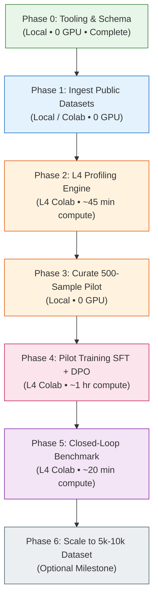

# GPUPerf-3B: Phased Development Roadmap

**Project:** GPUPerf-3B: A Profiler-Grounded GPU Optimization Model  
**Base Model:** `Qwen/Qwen2.5-Coder-3B-Instruct`  
**Fine-Tuning Stack:** QLoRA (4-bit NF4) + Unsloth / Hugging Face TRL  
**Primary Execution Hardware:** NVIDIA L4 (24GB VRAM) via Google Colab Pro or Cloud VM  
**Local Development:** Windows Workspace (`d:\GPUPerf-3B`)

---

## Roadmap Overview



---

## Phase 0: Local Tooling & PIR Schema (Completed ✅)

- **Objective:** Build the local software scaffolding to parse profiler dumps and eliminate context-window token waste.
- **Completed Components:**
  - `gpuperf/schema/pir.py`: Compact Profiler Intermediate Representation dataclasses ($<250$ tokens).
  - `gpuperf/profiler/ncu_parser.py`: Metric extraction and rule-based hardware bottleneck diagnoser (register spills, DRAM saturation, occupancy limits).
  - `gpuperf/profiler/ncu_runner.py`: NCU CLI execution wrapper and mock profiling generator.
  - `gpuperf/synthesis/trajectory_builder.py`: SFT & DPO prompt formatters.
  - Unit test suite: `tests/test_pir_schema.py` and `tests/test_ncu_parser.py`.
- **Environment:** Local PC (Windows)
- **Compute Time:** 0 GPU hours
- **Cost:** $0.00

---

## Phase 1: Ingest Public Datasets & Trajectory Mining

- **Objective:** Extract verified before/after optimization pairs and agent traces from public Hugging Face datasets.
- **Target Data Sources:**
  - `BonnieWang/KernelBenchX` (176 tasks, multi-round generation logs, measured speedups).
  - `Infatoshi/kernelbench-mega-traces` & `kernelbench-hard-traces` (Agent interaction logs).
  - `kerneldf/datakernelbench` (Database query kernel baselines).
- **Filtering Protocol:**
  - **Chosen Samples:** Iterations where runtime decreased and speedup $> 1.15\times$.
  - **Rejected Samples:** Iterations that regressed ($<0.95\times$ speedup) or caused compilation/runtime errors.
- **Key Script:** `scripts/download_public_datasets.py`
- **Deliverable:** `data/raw/public_pairs.jsonl` ($\sim 300$ high-quality seed trajectories).
- **Environment:** Local PC or Colab CPU
- **Compute Time:** 1–2 hours
- **Cost:** $0.00

---

## Phase 2: L4 Automated Profiling Engine

- **Objective:** Measure real physical hardware metrics on an NVIDIA L4 GPU for Triton and CUDA operators.
- **Methodology:**
  - Implement parametric sweeps over Triton operators (GEMM, Fused Attention, LayerNorm):
    - Tile Dimensions: `BLOCK_M/N/K` $\in \{32, 64, 128, 256\}$.
    - Warps: `num_warps` $\in \{2, 4, 8\}$.
    - Software Pipelining: `num_stages` $\in \{2, 3, 4, 5\}$.
  - Execute automated NCU CLI runs:
    ```bash
    ncu --csv --page=raw --metrics=sm__throughput.avg.pct_of_peak_sustained_elapsed,gpu__dram_throughput.avg.pct_of_peak_sustained_elapsed,sm__warps_active.avg.pct_of_peak_sustained_active,launch__registers_per_thread,smsp__sass_inst_executed_op_local_ld.sum ...
    ```
  - Record exact latency using `torch.cuda.Event`.
- **Key Script:** `scripts/run_l4_harvest.py` (running with active GPU).
- **Deliverable:** `data/l4_sweeps.jsonl` (200–300 measured L4 kernel variants).
- **Environment:** NVIDIA L4 (Google Colab Pro or GCP L4 VM)
- **Compute Time:** $\sim 45\text{ minutes}$
- **Cost:** $\approx \$1.00$

---

## Phase 3: Curate the 500-Sample Pilot Dataset

- **Objective:** Assemble a balanced, high-precision training dataset across 5 core optimization categories.
- **Dataset Composition (100 samples per bucket):**
  1. **100 Kernel Diagnoses:** (Kernel + PIR $\to$ Name exact bottleneck limiter).
  2. **100 Memory Bottleneck Refactors:** (Uncoalesced reads & bank conflicts $\to$ Coalesced layout).
  3. **100 Occupancy & Register Tuning:** (Spills & low warps $\to$ Tile downscaling & warp sizing).
  4. **100 Direct Optimization Improvements:** (Baseline $\to$ Refactored kernel with measured speedup $\ge 1.25\times$).
  5. **100 Negative/Failed Trajectories:** (Variants that slowed down or spilled $\to$ Causal explanation for DPO).
- **Deliverables:**
  - `data/sft_pilot.jsonl` (500 records in ShareGPT format)
  - `data/dpo_pilot.jsonl` (500 chosen/rejected pairs)
- **Environment:** Local PC
- **Compute Time:** 0 GPU hours
- **Cost:** $0.00

---

## Phase 4: Pilot Fine-Tuning (SFT + DPO)

- **Objective:** Train `Qwen2.5-Coder-3B-Instruct` using QLoRA on a single L4 GPU.
- **Stage 1: Supervised Fine-Tuning (SFT)**
  - Base: `Qwen/Qwen2.5-Coder-3B-Instruct` (4-bit NF4)
  - Config: `configs/sft_pilot_config.yaml`
  - Hyperparameters: LoRA rank $r=32$, $\alpha=64$, batch size 2, grad accum 4, lr $2\times 10^{-4}$, 3 epochs.
  - Training Time: $\sim 20–25\text{ minutes}$.
  - Output: `checkpoints/gpuperf_sft_pilot`.
- **Stage 2: Direct Preference Optimization (DPO)**
  - Base: `checkpoints/gpuperf_sft_pilot`
  - Config: `configs/dpo_pilot_config.yaml`
  - Hyperparameters: $\beta=0.1$, batch size 1, grad accum 8, lr $5\times 10^{-5}$, 1.5–2 epochs.
  - Training Time: $\sim 30–35\text{ minutes}$.
  - Output: `checkpoints/gpuperf_dpo_pilot`.
- **Environment:** NVIDIA L4 (24GB VRAM)
- **Total Training Time:** $\approx 1\text{ hour}$
- **Cost:** $\approx \$1.50$

---

## Phase 5: Closed-Loop Verification on Held-Out Test Kernels

- **Objective:** Prove empirical improvement over the base Qwen2.5-Coder-3B model.
- **Test Suite (GPUPerf-Eval-20):** 20 held-out kernels with diverse bottlenecks.
- **Evaluation Metrics:**
  - **Diagnostic Accuracy:** Matches NCU hardware ground-truth bottleneck.
  - **Compilation Pass Rate:** Kernels compile without syntax or runtime crashes.
  - **Correctness Pass Rate:** Produces numerically identical outputs to PyTorch baseline (`torch.allclose`).
  - **Empirical Speedup ($fast_p$):** Physical speedup on L4 hardware.
- **Key Script:** `scripts/evaluate_heldout.py`
- **Success Criteria:** $>80\%$ compilation pass rate and $>1.2\times$ average speedup on valid kernels.
- **Environment:** NVIDIA L4
- **Compute Time:** $\sim 20\text{ minutes}$
- **Cost:** $\approx \$0.50$

---

## Phase 6: Scaling Up (Post-Pilot Decision)

- **Objective:** Expand to a full-scale production model if Phase 5 meets success criteria.
- **Milestones:**
  - Scale dataset to **5,000–10,000 validated examples**.
  - Run full-scale SFT ($\approx 6–7\text{ hours}$) and DPO ($\approx 3–4\text{ hours}$).
  - Release model weights, dataset, and benchmark on Hugging Face / GitHub.
- **Environment:** NVIDIA L4
- **Compute Time:** $\sim 10\text{ hours}$ (overnight run)
- **Cost:** $\approx \$15.00$

---

## Budget & Compute Summary

| Phase | Hardware | Time | Estimated Cost |
| :--- | :--- | :--- | :--- |
| **Phase 0: Tooling & Scaffolding** | Local PC | Completed | **$0.00** |
| **Phase 1: Public Dataset Mining** | Local PC / Colab CPU | 1–2 hours | **$0.00** |
| **Phase 2: L4 NCU Profiling** | 1× NVIDIA L4 (24GB) | $\sim 45\text{ mins}$ | **$\approx \$1.00$** |
| **Phase 3: Curate 500-Sample Pilot** | Local PC | 1 hour | **$0.00$** |
| **Phase 4: SFT + DPO Fine-Tuning** | 1× NVIDIA L4 (24GB) | $\sim 60\text{ mins}$ | **$\approx \$1.50$** |
| **Phase 5: Closed-Loop Benchmark** | 1× NVIDIA L4 (24GB) | $\sim 20\text{ mins}$ | **$\approx \$0.50$** |
| **Total Pilot (Phases 0–5)** | — | **$\sim 2$ GPU hours** | **$\approx \$3.00$** |
| | | | |
| **Phase 6: Full-Scale Model (Optional)** | 1× NVIDIA L4 (24GB) | $\sim 10\text{ GPU hours}$ | **$\approx \$15.00$** |

