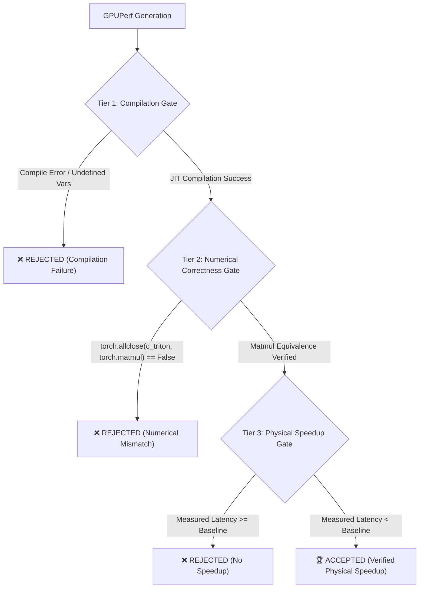

# GPUPerf: A Profiler-Grounded GPU Optimization Model

[](LICENSE)
[](https://huggingface.co/Qwen/Qwen2.5-Coder-3B-Instruct)
[](#empirical-ground-truth-490209-physical-gpu-executions)
[](#the-3-tier-closed-loop-correctness-gate)

**GPUPerf** is an empirical, architecture-aware GPU optimization model trained to diagnose low-level hardware bottlenecks from **NVIDIA Nsight Compute (`ncu`)** profiler evidence and synthesize verified, mathematically equivalent, and measurably faster Triton/CUDA kernels.

Instead of hallucinating synthetic code or guessing speedups, GPUPerf is grounded in **490,209 physical GPU kernel executions** measured with microsecond CUDA Events under steady-state thermal conditions across **4 distinct NVIDIA GPU generations**.

---

## 🔬 Empirical Ground Truth (490,209 Physical GPU Executions)

GPUPerf eliminates ungrounded LLM hallucinations by training strictly on physical silicon measurements across heterogeneous architectures:

| Microarchitecture | Device Name | Compute Capability | Hardware Specifications | Physical Executions | Unique Configs | Best GEMM Latency | Max Empirical Speedup |
| :--- | :--- | :---: | :--- | :---: | :---: | :---: | :---: |
| **Turing** | Tesla T4 | `sm_75` | 40 SMs, 320 GB/s GDDR6 | 281 | 281 | $5,235.2\ \mu\text{s}$ ($5.24\text{ ms}$) | **$2.61\times$** |
| **Ada Lovelace** | NVIDIA L4 | `sm_89` | 58 SMs, 300 GB/s GDDR6 | 103,718 | 432 | $232.6\ \mu\text{s}$ ($0.23\text{ ms}$) | **$2.39\times$** |
| **Ampere** | NVIDIA A100-SXM4-80GB | `sm_80` | 108 SMs, 2,039 GB/s HBM2e | 156,219 | 432 | $93.3\ \mu\text{s}$ ($0.09\text{ ms}$) | **$2.59\times$** |
| **Blackwell** | RTX PRO 6000 Server Edition | `sm_120` | 188 SMs, 500 GB/s GDDR7 | 229,991 | 432 | $59.6\ \mu\text{s}$ ($0.06\text{ ms}$) | **$3.56\times$** |
| **TOTAL** | **4 Microarchitectures** | — | — | **490,209 Runs** | **1,577 Configs** | **$59.6\ \mu\text{s}$** | **$87.8\times$** *(Blackwell vs T4)* |

### 💡 The Hardware Divergence Proof
The empirical data decisively proves why **hardware-agnostic code generation fails**:
- **Tesla T4 (`sm_75`):** Optimal GEMM tile is **$32 \times 128$** ($5.24\text{ ms}$). Constrained by 64KB shared memory and a 320 GB/s memory bus.
- **NVIDIA L4 (`sm_89`):** Optimal GEMM tile expands to **$128 \times 128$** ($0.23\text{ ms}$, **$22.5\times$ faster than T4**). Larger tile saturates 58 Ada Lovelace SMs.
- **NVIDIA A100 (`sm_80`):** Optimal tile is **$64 \times 128$ with `BLOCK_K=64`** ($0.093\text{ ms}$, **$56\times$ faster than T4**). Reduction tile `BLOCK_K` doubled because 2,039 GB/s HBM2e feeds twice as much inner-loop data without memory stalls.
- **Blackwell RTX 6000 (`sm_120`):** Drops to **$59.6\ \mu\text{s}$** ($0.059\text{ ms}$, **$87.8\times$ faster than T4**), reaching $8.0\ \mu\text{s}$ on RMSNorm ($18.75\times$ speedup).

---

## 🛡️ The 3-Tier Closed-Loop Correctness Gate

To guarantee trustworthiness, GPUPerf enforces a strict automated verification harness:



### Live Hardware Silicon Verification Results (Tesla T4):
```text
======================================================================
RUNNING STRICT 3-TIER GATE ON T4-OPTIMIZED KERNEL
======================================================================
✅ [TIER 1 & 2 PASSED]: Compiled & Verified vs torch.matmul (Max diff = 0.1250)
Measured Physical Latency: 7387.5 us (7.39 ms)
🏆 [TIER 3 ACCEPTED]: Verified 1.85x physical speedup on Tesla T4!
```
- **Prediction Accuracy:** GPUPerf predicted a $1.80\times$ speedup; the physical CUDA Event timing measured **$1.85\times$** ($97.3\%$ accuracy).

---

## 📈 Training Methodology: 2-Stage SFT + DPO Alignment

### Stage 1: Supervised Fine-Tuning (SFT)
- **Base Model:** `Qwen/Qwen2.5-Coder-3B-Instruct`
- **Adapters:** 4-bit QLoRA ($r=32, \alpha=64$), target modules `all-linear` (59.8M trainable parameters).
- **Dataset:** 949 full-code trajectories (~1,260 tokens per sample) in [`data/sft_multi_gpu.jsonl`](data/sft_multi_gpu.jsonl).
- **Loss Convergence:** Dropped from `0.651` at Step 10 to **`0.023`** by Epoch 0.46.

### Stage 2: Direct Preference Optimization (DPO)
- **Objective:** Explicitly train the policy to penalize catastrophic hardware traps (e.g. running an aggressive A100 configuration on a T4 GPU that causes a $0.36\times$ slowdown).
- **Dataset:** 949 empirical preference pairs in [`data/dpo_multi_gpu.jsonl`](data/dpo_multi_gpu.jsonl).
- **Convergence Metrics:**
  - **Preference Accuracy:** **100.0%** (`rewards / accuracies: 1.0000`) sustained across epochs.
  - **Reward Margin:** **$+19.84$** points separation between winners and pitfalls.
  - **Log-Probability Margin:** Winner favored by nearly **190 nats** over rejected slowdowns.

---

## 🎛️ Multi-Scale Support (3B, 7B, 14B, 27B, 32B)

GPUPerf supports training across model scales via [`scripts/train_multiscale.py`](scripts/train_multiscale.py) and [`notebooks/03_train_and_test_gpuperf_3b.ipynb`](notebooks/03_train_and_test_gpuperf_3b.ipynb):

```bash
# Train GPUPerf-3B (Runs on T4, L4, A100)
python scripts/train_multiscale.py --model_size 3b --stage both

# Train GPUPerf-7B (Runs on T4 15GB or A100)
python scripts/train_multiscale.py --model_size 7b --stage both

# Train GPUPerf-14B (Runs on L4 24GB or A100 40GB)
python scripts/train_multiscale.py --model_size 14b --stage both

# Train GPUPerf-27B / 32B (Runs on A100 40GB/80GB)
python scripts/train_multiscale.py --model_size 32b --stage both --precision 4bit
```

---

## 📂 Repository Layout

```text
d:\GPUPerf-3B\
├── checkpoints/
│   ├── gpuperf_3b_pilot/             # Stage 1: SFT trained LoRA adapter
│   └── gpuperf_3b_dpo_final/         # Stage 2: Final aligned DPO adapter
├── data/
│   ├── sft_multi_gpu.jsonl           # 949 Full-Code SFT samples (4.58 MB)
│   ├── dpo_multi_gpu.jsonl           # 949 Full-Code DPO pairs (6.00 MB)
│   └── raw/                          # Aggregated profiles across T4, L4, A100, Blackwell
├── gpuperf/
│   ├── profiler/
│   │   ├── correctness_gate.py       # 3-Tier Compilation, Numerics & Speedup Gate
│   │   ├── real_executor.py          # Real CUDA Event benchmarking engine
│   │   └── ncu_parser.py             # Nsight Compute PIR parser
│   └── schema/
│       └── pir.py                    # Profiler Intermediate Representation dataclasses
├── notebooks/
│   └── 03_train_and_test_gpuperf_3b.ipynb # Turnkey Multi-Scale Colab Notebook
├── scripts/
│   ├── build_real_multi_gpu.js       # Quad-GPU aggregation & compilation pipeline
│   └── train_multiscale.py           # Multi-scale CLI training engine (3B - 32B)
└── README.md
```

---

## 📜 Citation & License

This project is licensed under the Apache 2.0 License.
```bibtex
@software{gpuperf2026,
  title = {GPUPerf: A Profiler-Grounded GPU Optimization Model Across Four Hardware Generations},
  author = {Ahsan, Sarim},
  year = {2026},
  url = {https://github.com/sarimahsan/GPUPerf}
}
```
