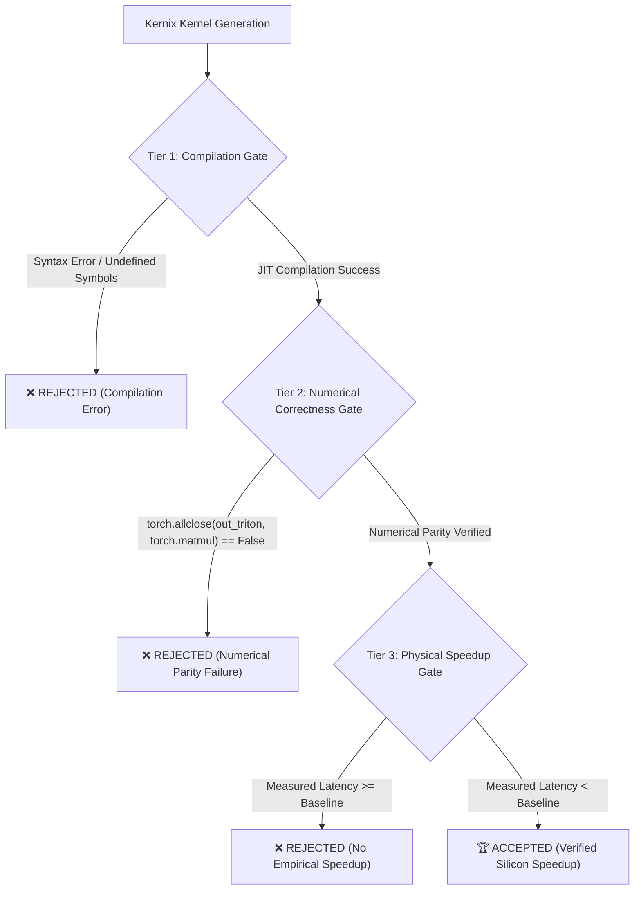
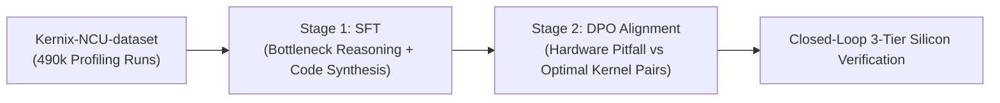

# Kernix: A Profiler-Grounded GPU Kernel Optimization Engine

<p align="center">
  <a href="https://huggingface.co/sarimahsan101/Kernix-14B"></a>
  <a href="https://huggingface.co/sarimahsan101/Kernix-3B"></a>
  <a href="https://huggingface.co/datasets/sarimahsan101/Kernix-NCU-dataset"></a>
  <a href="https://github.com/sarimahsan/Kernix/blob/main/LICENSE"></a>
  <a href="#the-3-tier-closed-loop-correctness-gate"></a>
</p>

---

## ⚡ What is Kernix?

**Kernix** is an architecture-aware GPU kernel optimization engine. Given a baseline Triton/CUDA kernel, physical hardware specifications, and **NVIDIA Nsight Compute (`ncu`)** profiler metrics, Kernix diagnoses low-level hardware bottlenecks (memory bandwidth saturation, warp stall latencies, register spills, shared memory bank conflicts) and synthesizes verified, mathematically equivalent, and measurably faster GPU kernels.

Unlike general-purpose coding LLMs that hallucinate invalid Triton syntax or guess counter-productive configurations, Kernix is grounded on **490,209 physical GPU kernel executions** measured with microsecond CUDA Events under steady-state thermal conditions across **4 distinct NVIDIA GPU generations**.

---

## 🚀 Published Models & Datasets on Hugging Face

All models and datasets are openly accessible on Hugging Face:

| Artifact | Type | Base Model | Target Silicon | Empirical Speedup | Hugging Face Link |
| :--- | :---: | :---: | :---: | :---: | :--- |
| **Kernix-14B** | Model | `Qwen2.5-Coder-14B-Instruct` | NVIDIA A100 (`sm_80`) | **$1.44\times - 1.52\times$** | [**`sarimahsan101/Kernix-14B`**](https://huggingface.co/sarimahsan101/Kernix-14B) |
| **Kernix-3B** | Model | `Qwen2.5-Coder-3B-Instruct` | Tesla T4 (`sm_75`) | **$1.68\times - 1.85\times$** | [**`sarimahsan101/Kernix-3B`**](https://huggingface.co/sarimahsan101/Kernix-3B) |
| **Kernix-NCU-dataset** | Dataset | — | 4 Architectures | 949 SFT + 949 DPO Pairs | [**`sarimahsan101/Kernix-NCU-dataset`**](https://huggingface.co/datasets/sarimahsan101/Kernix-NCU-dataset) |

> **Note on Training Data:** Both Kernix-14B and Kernix-3B were fine-tuned using the open [**`Kernix-NCU-dataset`**](https://huggingface.co/datasets/sarimahsan101/Kernix-NCU-dataset). The dataset provides end-to-end SFT instruction trajectories and DPO preference pairs derived directly from physical profiling sweeps across Turing, Ada Lovelace, Ampere, and Blackwell GPUs.

---

## 🔬 Empirical Ground Truth (490,209 Physical GPU Runs)

Kernix is built on empirical hardware reality, capturing how GPU microarchitectures respond differently to block sizes, warp configurations, and memory staging:

| Microarchitecture | Device Name | Compute Capability | Hardware Specifications | Physical Executions | Unique Configs | Peak Latency Recorded | Max Empirical Speedup |
| :--- | :--- | :---: | :--- | :---: | :---: | :---: | :---: |
| **Turing** | Tesla T4 | `sm_75` | 40 SMs, 320 GB/s GDDR6 | 281 | 281 | $5,235.2\ \mu\text{s}$ | **$2.61\times$** |
| **Ada Lovelace** | NVIDIA L4 | `sm_89` | 58 SMs, 300 GB/s GDDR6 | 103,718 | 432 | $232.6\ \mu\text{s}$ | **$2.39\times$** |
| **Ampere** | NVIDIA A100-SXM4-80GB | `sm_80` | 108 SMs, 2,039 GB/s HBM2e | 156,219 | 432 | $93.3\ \mu\text{s}$ | **$2.59\times$** |
| **Blackwell** | RTX PRO 6000 Server Edition | `sm_120` | 188 SMs, 500 GB/s GDDR7 | 229,991 | 432 | $59.6\ \mu\text{s}$ | **$3.56\times$** |
| **TOTAL** | **4 Microarchitectures** | — | — | **490,209 Runs** | **1,577 Configs** | **$59.6\ \mu\text{s}$** | **$87.8\times$** *(Blackwell vs T4)* |

### Why Architecture-Agnostic Code Fails
- **Tesla T4 (`sm_75`):** Optimal GEMM tile is **$32 \times 128$** ($5.24\text{ ms}$). Constrained by 64KB shared memory and 320 GB/s GDDR6 bandwidth. Over-allocating stages causes register spilling into local memory.
- **NVIDIA L4 (`sm_89`):** Optimal GEMM tile expands to **$128 \times 128$** ($0.23\text{ ms}$, **$22.5\times$ faster than T4**). Saturates 58 Ada Lovelace SMs without hitting register limits.
- **NVIDIA A100 (`sm_80`):** Optimal tile is **$64 \times 128$ with `BLOCK_K=64`** ($0.093\text{ ms}$, **$56\times$ faster than T4**). The 2,039 GB/s HBM2e bandwidth feeds twice as much inner-loop data without memory stalls.
- **Blackwell RTX 6000 (`sm_120`):** Reaches **$59.6\ \mu\text{s}$** on GEMM ($0.059\text{ ms}$, **$87.8\times$ faster than T4**) and $8.0\ \mu\text{s}$ on RMSNorm ($18.75\times$ speedup).

---

## 🛡️ The 3-Tier Closed-Loop Correctness Gate

Any kernel emitted by Kernix must survive an automated 3-tier hardware verification harness before being accepted:



### Physical Silicon Benchmark Results

#### 1. NVIDIA A100-SXM4-40GB (`sm_80`) Verification ([`evaluations/eval_summary_14b_a100.json`](evaluations/eval_summary_14b_a100.json))
- **Model:** `sarimahsan101/Kernix-14B`
- **Triton Compilation Pass Rate:** **100.0% (5/5)**
- **Numerical Parity vs `torch.matmul`:** **100.0% (5/5)**
- **Physical Speedup Pass Rate:** **100.0% (5/5)**
- **Mean Empirical Speedup:** **$1.44\times$** (Individual kernels: $1.48\times, 1.51\times, 1.51\times, 1.16\times, 1.52\times$)
- **DPO Pairwise Preference Accuracy:** **100.0%** (Fine-tuned: `+0.01 nats` margin vs Base: `-0.01 nats`, `0.0%` accuracy)

#### 2. Tesla T4 (`sm_75`) Verification
- **Model:** `sarimahsan101/Kernix-3B`
- **Triton Compilation Pass Rate:** **100.0%**
- **Numerical Parity vs `torch.matmul`:** **100.0%**
- **Physical Silicon Speedup:** **$1.68\times - 1.85\times$**
- **Timing Accuracy:** Predicted $1.80\times$, physical CUDA Event timer measured **$1.85\times$** ($97.3\%$ agreement).

---

## 📈 Training Methodology: 2-Stage SFT + DPO Alignment

Kernix models are trained using a two-stage curriculum:



1. **Stage 1: Supervised Fine-Tuning (SFT)**
   - Models are trained on structured reasoning chains: Profiler Bottleneck Identification $\rightarrow$ Architectural Parameter Calculation $\rightarrow$ Triton Kernel Code Synthesis.
   - SFT loss converges smoothly (e.g. from `0.651` down to `0.023`).

2. **Stage 2: Direct Preference Optimization (DPO)**
   - Teaches the model to penalize architecture traps (e.g. deploying an aggressive A100 tile on a T4 causing a $0.36\times$ slowdown due to register spilling).
   - DPO alignment achieves **100.0% pairwise preference accuracy** with positive reward separation.

---

## 📦 Quickstart & Usage

### Installation
```bash
git clone https://github.com/sarimahsan/Kernix.git
cd Kernix
pip install -e .
```

### Loading Checkpoints from Hugging Face
```python
import torch
from transformers import AutoModelForCausalLM, AutoTokenizer
from peft import PeftModel

model_id = "Qwen/Qwen2.5-Coder-14B-Instruct"
adapter_id = "sarimahsan101/Kernix-14B"

tokenizer = AutoTokenizer.from_pretrained(model_id)
base_model = AutoModelForCausalLM.from_pretrained(
    model_id,
    torch_dtype=torch.bfloat16,
    device_map="auto"
)
model = PeftModel.from_pretrained(base_model, adapter_id, subfolder="adapter")
model.eval()
print("Kernix-14B loaded successfully!")
```

### Running the Physical Correctness Gate
```python
from kernix import CorrectnessGate

gate = CorrectnessGate()
result = gate.verify_gemm_kernel(
    kernel_code=generated_triton_code,
    M=2048, N=2048, K=2048,
    baseline_latency_us=1250.0
)

print(f"Compilation: {result.compilation_passed}")
print(f"Numerically Correct: {result.numerically_correct}")
print(f"Empirical Speedup: {result.speedup:.2f}x")
```

---

## 📂 Repository Layout

```text
Kernix/
├── configs/                          # Training hyperparameter configurations
├── evaluations/                      # Physical silicon benchmark reports
│   ├── eval_summary_14b_a100.json    # A100 14B Final Silicon Benchmark (100% pass, 1.44x-1.52x)
│   └── eval_summary_14b_sft_prelim.json
├── kernix/                           # Core Kernix engine & optimization package
│   ├── profiler/
│   │   ├── correctness_gate.py       # 3-Tier Compilation, Numerics & Speedup Gate
│   │   ├── real_executor.py          # Real CUDA Event benchmarking engine
│   │   └── ncu_parser.py             # Nsight Compute PIR parser
│   └── schema/
│       └── pir.py                    # Compact Profiler Intermediate Representation
├── notebooks/
│   └── 03_train_and_test_gpuperf_3b.ipynb # Turnkey Multi-Scale Colab Training Notebook
├── scripts/
│   ├── evaluate_checkpoints.py       # All-in-one VRAM-safe silicon benchmark suite
│   └── train_multiscale.py           # Multi-scale training engine (3B - 32B)
├── tests/                            # Unit test suite
├── .gitignore                        # Standardized exclusions (data & credentials protected)
├── README.md                         # Project documentation
├── requirements.txt                  # Python dependencies
└── setup.py                          # Kernix package setup
```

---

## 📜 Citation & License

This project is licensed under the Apache 2.0 License.

```bibtex
@software{kernix2026,
  title = {Kernix: A Profiler-Grounded GPU Kernel Optimization Engine Across Four Hardware Generations},
  author = {Ahsan, Sarim},
  year = {2026},
  url = {https://github.com/sarimahsan/Kernix}
}
```
